# HYX Scene Studio 用户手册

适用版本：界面教程以 2026 年 10 月 10 日的审核版本为基础，四相机视频、转向提示和导出流程已按 2026 年 10 月 19 日的 map10 实测更新。运行环境为 Windows、Python 3.10、CARLA 0.9.15，以及项目自定义的 map10 地图。

本手册面向编排驾驶场景、采集车辆轨迹、进行视觉环境对照和手动接管实验的使用者。**第一次用，先完成第 2 节启动，再照着[第 3 节的五步截图](#3)做一次录制。**想先认按钮，可看[第 4 节界面总览](#4)。修改实验条件时查第 5—10 节；准备正式实验时重点阅读第 11—14 节。代码修改、接口调用和故障恢复见[开发维护手册](developer-maintenance-manual.md)。

图中黄色框的编号对应图下说明；**点击图片可以放大，再点“原始尺寸”看清小字**。截图来自本机真实操作，场景名称、运行编号和时钟会随你的操作变化。基础操作截图使用“图文练习 · 加速与变道”；新增四相机画面及下载入口截图来自 map10 短时复测。

## 1 软件能做什么

HYX Scene Studio 是 CARLA 的本地控制界面。你在浏览器中安排车辆、路线和动作，软件通过 CARLA 运行它们，并保存实际发生的运动与控制数据。CARLA 必须事先启动。

软件有两种工作方式：

| 工作方式 | 适用任务 | 车辆怎样运动 | 主要结果 |
|---|---|---|---|
| 运动编排 | 设计跟车、急刹、切入等场景，进行手动接管 | 控制器输出油门、制动和转向，由 CARLA 物理计算运动 | 实际轨迹、控制量、事件、截图 |
| 固定轨迹 · 环境 | 保持车辆运动，比较光照、天气和相机画面 | 按已录制的位置和姿态逐帧重放 | 相同运动条件下的视觉记录 |

一次典型研究流程是：**复制模板 → 修改场景 → 预演检查 → 实机录制 → 核验数据 → 锁定轨迹 → 改变环境并重放**。

固定轨迹适合视觉 A/B 对照。它不会重新计算雨天轮胎摩擦，也不会让背景车辆自动避让接管后的主车。需要比较车辆动力学时，应分别进行物理运行并核对实际轨迹。

## 2 启动与退出

### 2.1 日常启动

1. 在 CARLA / UE 编辑器中打开 map10，点击 **Play**。预期地图路径为 `package/Maps/map10/map10`，CARLA API 默认端口为 `2000`。
2. 双击项目根目录的 `Start-SceneStudio.cmd`，保持打开的服务窗口运行。
3. 浏览器打开 `http://127.0.0.1:8877/`。顶部连接栏应显示当前地图名称，中间应出现道路和场景参与者。
4. CARLA 启动较晚时，点击 **刷新连接**。

默认地址是 8877。本机当前更新服务使用 **8880**，可访问 `http://127.0.0.1:8880/`；维护者指定了其他端口时，以实际启动地址为准。不同端口的旧服务可能加载不同版本代码，正式实验应只使用确认过的那个服务。

软件不会自动切换地图。开始运行前，CARLA 应处于异步模式并开启渲染；其他会推进仿真的客户端应先停止。启动时提示地图不匹配或世界已被同步客户端占用，应先解决提示，再运行场景。

### 2.2 新电脑首次安装

代码仓库不包含 map10 的 UE 地图资产。先准备匹配的 CARLA 与地图工程，再在项目目录中执行：

```powershell
python -m venv .venv
.\.venv\Scripts\python.exe -m pip install -r requirements-studio.txt
.\.venv\Scripts\python.exe -m scene_studio.server
```

这里的 `python` 应为 Python 3.10。日常使用不需要重复安装依赖。双击启动脚本时，会优先使用项目 `.venv`，然后尝试本机已配置的 Python。

### 2.3 正常退出

先点击 **停止**，等待状态变为 **已结束**或明确的错误状态，再关闭服务窗口。正常结束会清理本次创建的车辆、相机等对象，恢复进入会话前的天气与世界设置。

关闭浏览器不等于停止后台仿真。若关闭了页面，重新打开同一服务地址查看会话状态。异常断电或进程崩溃的恢复方法见第 15 节和开发维护手册。

## 3 第一次完成一段录制

先用自带模板走通一次，不用新建车辆、输入坐标或画路线。这一轮只做：**选模板 → 保存副本 → 看动作 → 实机录制 → 找到记录**。

### 3.1 选模板并保存自己的副本

在左上角场景下拉框选择 **时间轴示例 · 加速与变道**。点右上 **文件 → 另存为**，再把上方名称改成“图文练习 · 加速与变道”，点 **保存**。

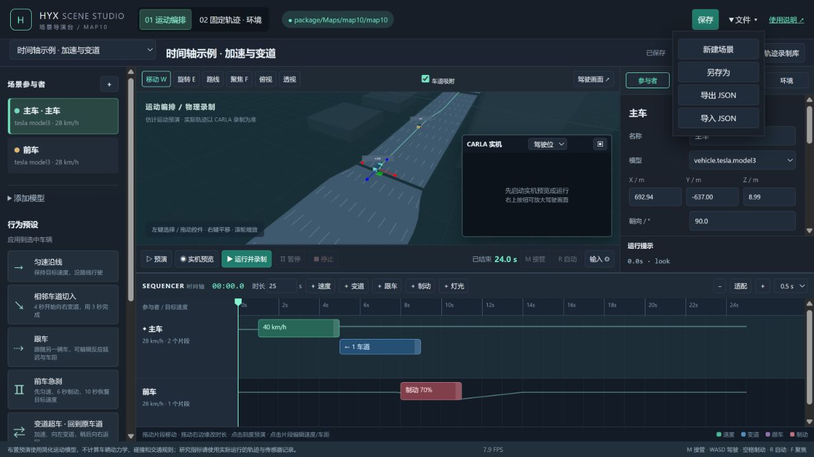

**做对后看到什么：**上方名称变成你的练习名称，旁边显示“已保存”，底部总时长是 25 秒。若本地模板以前被修改过，先检查实际参数，不要只按名称判断。

### 3.2 点一下片段 看懂车辆什么时候动作

在底部 **主车**这一行，点绿色的 **40 km/h**片段。右侧切换到片段属性，能看到 **开始 1 秒、持续 4 秒、目标速度 40 km/h**。这表示第 1—5 秒逐渐提高目标速度，之后保持；第一次练习保留这些数值即可。

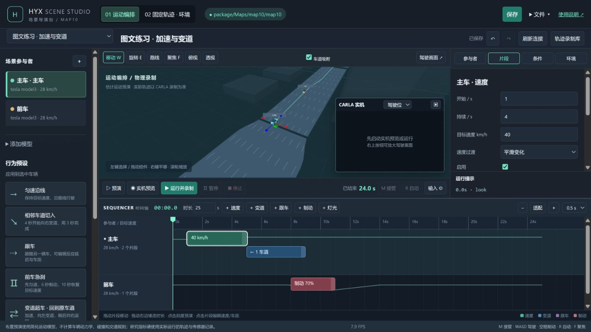

主车蓝色片段表示第 5—9 秒向左变道；前车红色片段表示第 8—11 秒制动。**先点哪个片段，右侧就编辑哪个片段**。改完数值要保存。此处不需要再点“＋速度”，否则会多加一个片段。

### 3.3 先查看真实画面

点 **预演**只看简化车辆的大致运动，再点一次停止。点 **实机预览**后，等状态显示“布置预览”，中间的小相机窗口应出现真实道路。

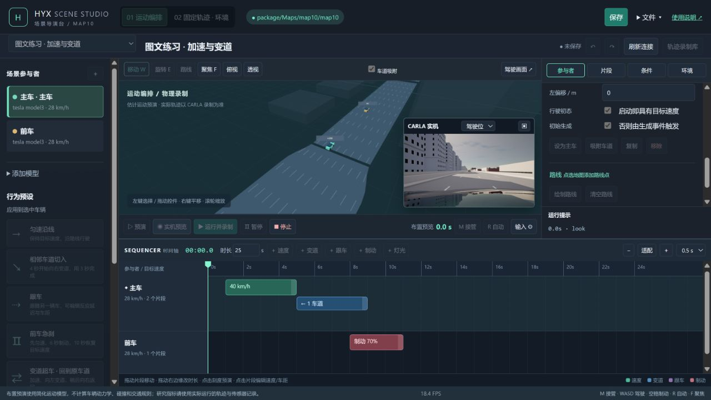

**做对后看到什么：**小窗口里有 CARLA 道路画面，状态写“布置预览”。可以点时间刻度查看布置；要真正运行，先点 **停止**并等它结束。

### 3.4 运行并录制到终点

点绿色 **运行并录制**，等状态从“启动中”变成“运行中”。此时时钟前进、车辆实际运动、编辑按钮变灰。第一轮可以直接等到 **25.0 秒**自动结束。

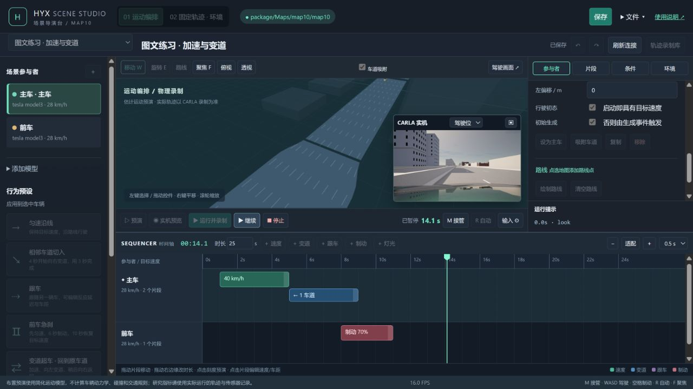

图中为了展示按钮，已经在 **14.1 秒暂停**。如果你也点了暂停，再点 **继续**才能往下跑；暂停时钟不走是正常的。**停止会提前结束这一段**，不等于暂停。第一次练习不必接管，接管操作见第 9 节。

### 3.5 找到刚才录下来的内容

运行结束后，在左侧向下滚动，展开 **最近运行**。找你的练习名称：正式完成的记录应显示 `finished · 25.0s`。同名的 `0.0s`条目可能是刚才的布置预览，不要把它当成这段正式录制。

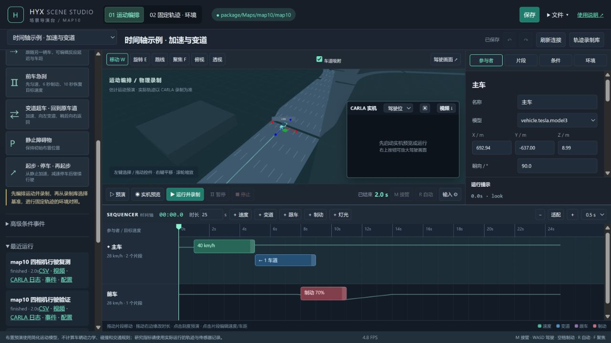

**CSV**下载车辆数据表，**视频**下载四相机合成画面，**CARLA 日志**下载原生回放文件；**事件**和**配置**分别下载事件记录与本次场景参数。画面区右上角的 **视频 ↓**下载最近一次完整运行的视频。截图取自 2 秒功能复测，你的练习记录应按自己的名称和 25 秒时长核对。重新打开服务后，即使会话时钟显示“尚未运行”，左侧仍能查看历史记录。

随后点上方 **轨迹录制库**，核对练习名称、运行编号与 25.0 秒实际时长。想保持这次运动、换一种光照，接着按[第 10 节的截图](#10)操作。

成功标准是：状态为 **已结束**、无运行异常、实际时长达到设计终点，且运行目录中的 `take.json` 同时显示 `complete: true` 和 `covers_scene_duration: true`。录制库出现记录本身不能证明已跑完全程，提前正常停止的记录也可能入库。

当前本机还安装了 Case172 场景库。例如 **P02 · 前车明显制动，主车跟停** 的设计时长为 24 秒。该场景库的批量安装和验收工具见开发维护手册；新下载的项目不会仅靠打开页面就自动生成这 26 个场景。

## 4 认识界面和保存方式

### 4.1 界面分区

先记住五个位置：**左上选场景，左侧选车，右侧改参数，底部排动作，中间下方运行**。右侧属性区和左侧列表都能各自滚动；找不到参数时，把鼠标放到对应区域再滚轮下翻。

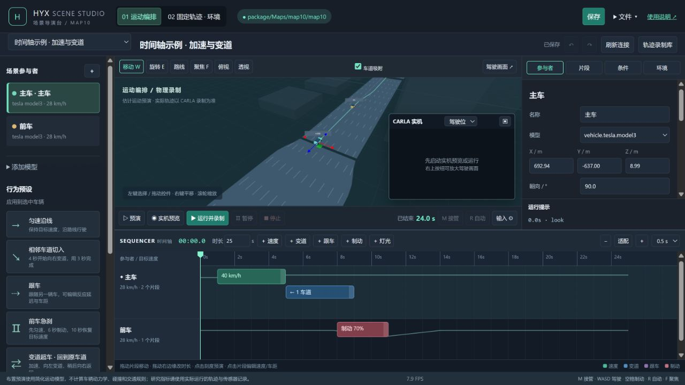

| 区域 | 用途 |
|---|---|
| 顶部模式栏 | 切换运动编排与固定轨迹环境对照，查看连接，保存和导入导出 |
| 场景名称栏 | 选择已保存场景、改名、撤销重做、刷新连接、打开轨迹库 |
| 左侧 | 选择或添加参与者，应用行为预设，编辑高级条件事件，查看最近运行 |
| 中间地图 | 布置车辆、绘制路线、观察估计运动 |
| CARLA 实机窗口 | 查看真实相机，切换驾驶位、追随和俯视视角 |
| 右侧属性 | 编辑选中的参与者、片段、条件或环境 |
| 底部时间轴 | 设置总时长，添加片段，改变片段开始时间与持续时间 |
| 播放控制栏 | 预演、实机预览、录制、暂停、停止、手动接管 |

中间地图使用简化模型。道路形状来自地图道路数据，不等同于 CARLA 中每一条可见车道线；道路拓扑错误和材质上的车道线错误需要分别检查。

地图中左键选择或操作控件，右键平移，滚轮缩放。**聚焦 F**用于找到选中参与者。地图工具栏的 **俯视**改变编辑视图；相机下拉框的 **俯视**改变真实相机，两者是不同入口。

### 4.2 保存、另存为、导入与导出

**保存**把当前场景写入本机场景库。已有场景再次保存时，旧文件会备份到 `studio_data/history/`。**另存为**创建并保存新编号的副本，适合保留基准后再改条件。

**导出 JSON**下载当前页面中的配置，包含尚未保存的修改。**导入 JSON**校验文件后替换当前草稿，仍需点击保存才能进入场景库。运行按钮也能使用未保存草稿，但不会自动将草稿保存到场景库；本次实际启动配置另存在运行目录的 `scene.json`。

**导出可运行 .py**将当前草稿及输入设备设置写入一份 Python 文件，可选择 10、20、40 或 60 Hz。先在 CARLA 中打开对应地图并进入 Play，再用项目的 Python 3.10 运行下载的文件。它直接连接本机 CARLA，不需要浏览器或编辑器服务继续运行；但仍需本项目的 `scene_studio` 代码和依赖，移动项目后可加 `--project-root 项目目录`。本机双击 `.py` 会打开 VS Code，应使用其中的“运行 Python 文件”，或在终端执行 `python 下载的文件.py`。

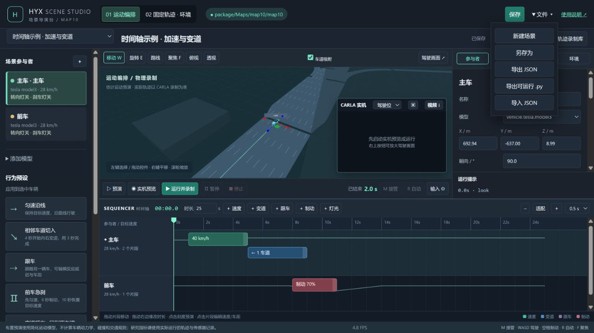

脚本默认打开实时相机窗口；按 **M** 接管，**W/S/A/D** 控车，**空格**制动，**R** 交回自动，**Q** 或 **Esc** 提前结束。导出时保存的手柄/方向盘设置也可用于脚本，运行时可加 `--input keyboard` 临时改用键盘。没有显示器的批量运行可加 `--no-window`。每次运行生成新的 `studio_data/runs/py_.../`：`video.mp4` 是 5740×1010 的前景及三面后视镜合成视频，`carla_replay.log` 可交给 CARLA 原生回放接口，`telemetry.csv` 记车辆状态，`trajectory.jsonl` 记逐帧轨迹，`events.json` 记事件，`driver_input.csv` 记窗口读取到的驾驶输入，`take.json` 标明是否覆盖计划时长，`console.txt` 保存诊断。脚本不采集眼动数据。环境重放仍需保留原基准运行目录。

未保存的草稿只在页面内存中，没有自动恢复保证。离开页面时的提醒不代表已经保存。撤销和重做最多保留约 50 个编辑快照；切换或新建场景会清理相应编辑历史。

软件没有历史版本浏览器。恢复旧配置时，先保留当前版本，再从 `studio_data/history/` 找到需要的 JSON，通过 **导入 JSON**查看，确认后另存为。

## 5 布置参与者和路线

### 5.1 添加和选择主车

左侧 **＋**添加默认轿车；**添加模型**提供轿车、消防车、摩托车和行人快捷入口。对象添加在当前视图中心附近，然后使用移动和旋转控件布置。车型列表不支持直接拖入地图。

右侧 **模型**列表来自当前 CARLA，实际可用车型由地图服务端决定。修改位置前，停止会话、切回运动编排，并把播放头移到 **0 秒**。

**主车**是相机和手动驾驶的对象。选择车辆后点击 **设为主车**；主车必须是车辆，并勾选 **初始生成**。背景参与者可以取消初始生成，之后由条件事件生成。

### 5.2 主要参数的含义

选中左侧主车，点右侧 **参与者**页签，再在该面板内向下滚动，即可找到速度和加减速度。图中 **28 km/h**是车辆基础目标速度，时间轴片段随后可以改变它。

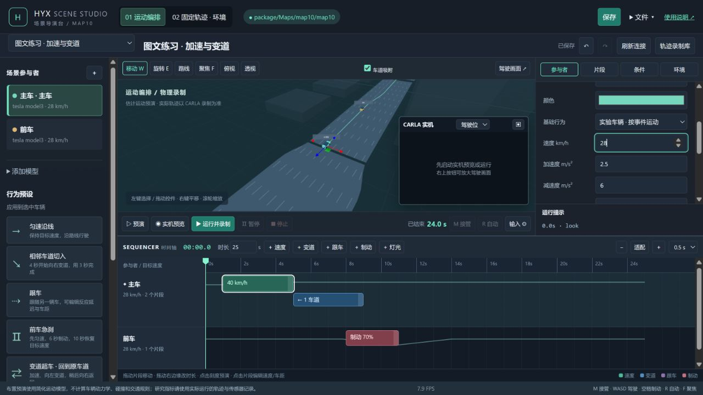

| 参数 | 单位与作用 |
|---|---|
| X、Y、Z | 米；地图世界坐标，Z 为高度 |
| 朝向 | 度；控制初始车头方向 |
| 速度 | km/h；自动控制的目标速度，范围 0—180，不保证瞬时达到 |
| 加速度、减速度 | m/s²；限制控制器内部命令速度的变化率，实际加减速还受车辆动力学影响 |
| 左偏移 | 米；正值向路线左侧，负值向右侧，范围 −10—10 |
| 启动即具有目标速度 | 初始赋速；不勾选时从静止开始，之后仍由控制器驱动 |
| 初始生成 | 运行开始时生成；未勾选的背景对象需要生成事件 |
| 基础行为 | 实验车辆按编排运动；普通交通使用本软件的自适应跟车；静止障碍物保持静止；行人沿点移动 |

加减速度斜坡和初始赋速说明适用于车辆。初始赋速仅作用于启动时已生成的非静止车辆；之后由事件生成的车辆不经过这一初始化。行人不使用车辆的加减速斜坡与初始赋速开关。行人和延迟生成车辆的起步状态应单独实测。

“普通交通”不是自动生成整个城市的随机交通，也不代表接入了 CARLA Traffic Manager 的完整路权系统。

**吸附车道**用于把对象重新定位到道路。手填坐标会关闭该对象的吸附标记；改完后若需沿道路起步，重新点吸附车道，并在真实画面中检查高度和重叠。

### 5.3 绘制路线

1. 选择一个参与者，点击工具栏 **路线**或右侧 **绘制路线**。
2. 沿期望方向依次点击道路，生成有序路线点。车辆点会吸附道路，行人点不吸附。
3. 点击 **完成绘制**退出。在停止的运动编排状态下，右侧可以修改路线点 X、Y，也可以删除某个点或清空路线；当前没有拖动路线点、单独修改点 Z 和重新排序点的入口。
4. 点击预演，检查实际规划出的连接路径。

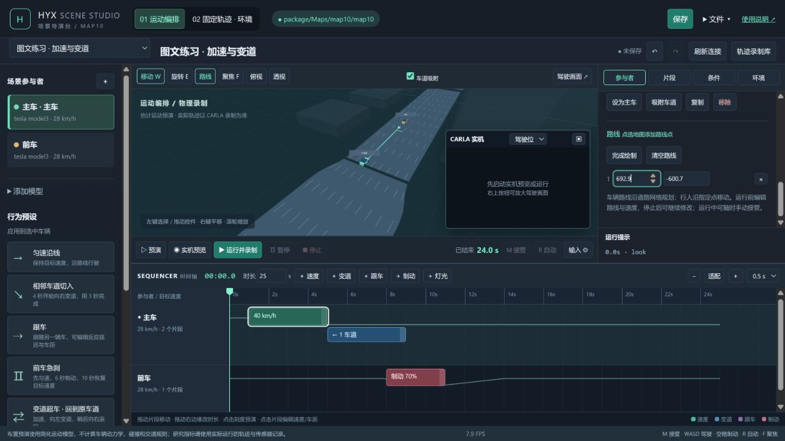

图中只演示“点击道路 → 出现坐标点 → 完成绘制”的过程，截图后已撤销这个点。**第一次做第 3 节练习时保留模板路线即可，不必照抄图中坐标。**以后自己设计路线，再按上面步骤逐点添加。

车辆会沿道路网络连接这些点，不会把任意两个点直接当成可驾驶直线。空路线会根据当前车道向前规划。跨越隔离带、逆向放点、道路断裂都可能导致规划失败或路径不符合预期。

**复制**参与者会复制它的片段，生成新编号并偏移位置，但不会复制引用它的条件事件。**移除**参与者还会清理引用它的事件、跟车片段及失去依赖的后续事件；删除前先保存副本。

## 6 使用时间轴安排动作

时间轴适合“第几秒做什么、持续多久”的编排。先选车辆，再点击 **＋速度、＋变道、＋跟车、＋制动、＋灯光**。新片段通常从播放头开始、持续 3 秒；有冲突时会尝试寻找后续空位，剩余空间不足则拒绝添加。

拖动片段改变开始时间，拖动右边缘改变持续时间。点击片段可在右侧准确填写开始、持续时间、启用状态和动作参数。时间吸附可选 0.1、0.5 或 1 秒；**− / 适配 / ＋**控制时间轴显示比例。

### 6.1 五种片段

| 片段 | 运行期间 | 结束以后 |
|---|---|---|
| 速度 | 从上一目标速度逐渐变到指定目标，可选线性或平滑过渡 | 保持新的目标速度 |
| 制动 | 油门为零，按 0—1 的强度制动；路线转向仍继续 | 恢复自动速度控制 |
| 变道 | 在设定时长内改变横向目标偏移，可向左或右跨 1—3 条车道 | 保持新偏移；后续变道在此基础上累加 |
| 跟车 | 对指定前车使用反应延迟、最小车距和时间车距约束 | 移除这段显式跟车关系；普通交通行为仍可能自动选择前车 |
| 灯光 | 独立设置转向灯、刹车灯与照明灯的组合 | **恢复片段开始前的灯光状态** |

跟车片段默认反应延迟 0.8 秒、最小车距 4 米、时间车距 1.2 秒。时间车距表示随速度增加的跟随距离要求；反应延迟是模型参数，不是对被试反应时间的测量。目标速度仍限制车辆的期望速度，跟车效果需用实际运行核验。

变道是路线偏移控制，不自动证明目标车道存在、允许变道或没有其他车辆。正式实验前应检查车道方向、可用宽度和切入时序。

### 6.2 冲突规则

同一辆车同一动作通道的启用片段不能重叠。**速度与制动属于同一个纵向通道**；例如 2—6 秒加速期间不能再放 4—5 秒制动。可改为 2—4 秒加速、4—5 秒制动、5—7 秒恢复目标速度。

### 转向灯与刹车灯

选中车辆，在“参与者 → 车灯状态”设置初始状态：

- **转向灯**：关闭、左转向灯、右转向灯。左右始终以车头方向为准。
- **刹车灯**：关闭、打开；可与任意转向灯组合。
- **照明灯**：保留示宽、近光和远光选项。已有双闪场景仍可正常读取。

要在指定时段亮灯，添加“＋灯光”片段，设置开始时间、持续时间及上述选项。片段内采用该灯态组合，结束后恢复初始灯态。灯光片段不与同车的灯光事件混用。

**灯光与运动独立**：打开刹车灯不会施加制动，关闭刹车灯也不会解除制动。变道不会自动开启转向灯；可将变道片段与灯光片段并排编排，明确控制是否提前打灯及持续多久。这适合比较有灯提示、无灯提示等实验条件。

Studio 简化车辆显示前后黄色转向灯与尾部红色刹车灯。实机调用 CARLA 车辆原生灯光；已用 map10 的 `vehicle.tesla.model3` 实拍核对前后左右转向灯、尾部刹车灯。其他车型的灯位和材质由其 CARLA 模型决定，正式实验前应按所选车型检查。

主车转向灯开启时，驾驶画面中心略偏左下方显示小型绿色方向提示。Studio 预览、截图、导出视频和 `.py` 驾驶窗口使用同一合成画面，提示会出现在这些文件中。灯态写入 `telemetry.csv` 的 `lights` 列及轨迹文件，固定轨迹重放按记录恢复。提示按仿真时间闪烁，不可直接当作被试屏幕实际呈现时刻。

不同车辆可以同时动作；同一辆车的速度、变道和灯光可在不同通道并行。拖动造成非法重叠时会回退；手工填写后的校验错误要修正后才能运行。**复制片段**通常接在原片段后面，空间不足或冲突时会拒绝。

每个片段至少持续 0.1 秒，且必须完全位于场景时长内。总时长必须是仿真步长的整数倍。当前界面只允许为车辆添加片段；行人速度片段虽有配置层支持，尚无正常的界面添加入口。

### 6.3 行为预设

左侧提供 **匀速沿线、起步 · 停车 · 再起步、前车急刹、相邻车道切入、变道超车 · 回到原车道、跟车、静止障碍物**。

预设应用到当前选中的车辆，会**替换它原有的片段**。该车已启用的旧运动事件会改为事件标记，以保留其他事件的依赖。应用前另存为；应用后检查整条时间轴、跟车目标和事件列表，再运行。

### 6.4 双车练习

选择 **时间轴示例 · 跟车与前车制动**，另存为练习副本。原始模板中主车在 0—25 秒跟随前车，前车在 6—10 秒以 0.8 强度制动。先录制原参数，再只修改前车制动强度并另存为第二个条件。

比较时检查前车实际减速、主车实际速度和两车位置。离线预演不计算真实跟车响应，因此不能用预演中看起来“没有追尾”作为成功标准。

## 7 高级条件事件

需要“距离小于某值才制动”或“前一个事件发生后再等待一段时间”时，使用左侧 **高级条件事件 → ＋条件事件**，并在右侧 **条件**面板设置触发方式与动作。每个启用事件在一次物理运行中只触发一次。

| 触发方式 | 应填写的条件 |
|---|---|
| 仿真时间 | 从本次试次开始计算的秒数，不包含暂停时长 |
| 通过坐标 | 参与者的 X 或 Y 坐标与指定米数比较 |
| 参与者间距离 | 两个参与者在 XY 平面上的中心点距离，单位米 |
| 接近地点 | 到给定 X、Y 地点的平面距离 |
| 参与者速度 | 实际速度与阈值比较，单位 km/h |
| 另一事件之后 | 选择前置事件，再填写延迟秒数 |

距离条件不等于保险杠之间的净空。要表达“进入 10 米内”，应使用小于或等于 10。事件每个仿真步检查一次，实际触发时刻可能晚于理论阈值一个步长；同一步多个事件按列表顺序处理，顺序可能影响结果。

当前实现写入设计终点的最后一帧后直接结束，不再检查该时刻的条件。因此不要把结束标记安排在恰好等于总时长的位置，应至少提前一个步长；是否到达计划终点用实际轨迹时长核验。

例如，先建“5 秒时记录风险开始”的**事件标记**，再建“该事件 2 秒后记录观察窗结束”的标记，运行后在 `events.json` 核对触发时刻。标记只记日志，不会自动播放提示音。

事件动作支持速度、制动、变道、偏移、跟车、沿绘制路线行驶、灯光、切换光影、生成或移除参与者、标记和结束场景。注意以下差异：

- 制动事件没有片段结束时刻，会持续制动，直到后续速度动作清除制动覆盖；制动值设为 0 表示滑行，不等于恢复自动速度控制。
- 变道事件使用**变道距离（米）**；变道片段使用**持续时间（秒）**。
- 同车同通道不能混用启用的事件动作与时间轴片段，即使它们设想发生在不同时间，也会被校验拒绝。
- 固定轨迹重放不重新执行场景事件。需要环境 A/B 时，先选定静态环境参数再从头重放。

界面目前保留了“立即执行动作”按钮，但它没有可用的常规运行操作流程，不作为本手册的测试或实验入口。

## 8 预演、运行和时间怎样对应

### 8.1 三种查看方式

| 按钮 | 使用 CARLA 真实画面 | 计算物理运动 | 可拖动时间 | 生成可重放轨迹 |
|---|---|---|---|---|
| 预演 | 否 | 否 | 可以 | 否 |
| 实机预览 | 是 | 否；运动模式按估计位置，环境模式按已录制姿态布置 | 可以 | 否 |
| 运行并录制 | 是 | 是 | 不可以 | 正常产生多帧并封存后可以 |

环境模式的 **重放并录制**使用已有实际轨迹。任何实机会话都应先停止，再开始另一场。暂停状态下仍属于运行中的会话，不能编辑运动，也不能跳帧。

### 8.2 tick 与同步模式

可以把 CARLA 想成一本逐页计算的动态画册。一次 **tick**就是“请计算下一页”：接收当前控制命令，推进物理，得到下一帧车辆状态。**同步模式**表示 CARLA 等待控制程序发出这次推进请求，再计算下一步。

本软件默认每步推进 **0.05 秒仿真时间**，因此 20 步等于 1 秒仿真时间。若电脑花了 2 秒才算完这 20 步，场景时钟仍只增加 1 秒。仿真时间、电脑现实经过的时间、相机图像到达速度是三个不同量。

界面里的相机 **FPS**是图像回调到达率，不直接等于物理仿真步数或屏幕显示帧率。驾驶视角正式录制固定使用 5740×1010 画布：前景加左、右、中央三面后视镜；Studio 预览用较小的同构画面。正式录制会适度等待相机，因此高分辨率试次可能明显慢于现实时间。视频编码帧率取场景相机设置，遇到相机缺帧会重复前一画面填齐时间轴；编码帧率不等于独立画面的实际采样率。默认 0.05 秒步长下，把相机采样设成 60 Hz 不能保证每个仿真秒得到 60 张独立图像。当前界面不提供步长编辑器，修改场景配置中的步长应按维护手册验证。

当前场景校验接受 0.1、0.05、0.025 和 1/60 秒步长，分别对应 10、20、40、60 Hz。早期 20/40 Hz 完整测试与 1/60 秒被拒绝的报告是修改前基线；本次新增的 Python 导出已通过 60 Hz 短时实机运行。这里的 60 Hz 指车辆状态步长，不等于显示器呈现、相机图像、方向盘或眼动都达到 60 Hz；这些还需按正式实验配置单独验证。

### 8.3 目标速度怎样变成车辆运动

控制过程是：**路线与目标速度 → 控制器 → 油门、制动、转向 → CARLA 物理 → 实际位置与速度**。

`vehicle.apply_control(control)` 把一组控制输入交给车辆。`control` 中常用的油门和制动范围为 0—1，转向范围为 −1—1。这个调用本身不返回车速，Python 返回值为 `None`；运动结果要看后续仿真步的状态。因此“目标 40 km/h”与“CSV 里实际 40 km/h”不是同一件事。

### 8.4 暂停

**暂停**会冻结试次时间和本次参与者的运动，同时仍允许世界推进以刷新画面。暂停时看到新图像并不表示实验时间继续增长。正式轨迹与截图会排除暂停和预热帧，所以 CSV 的世界帧号可能跳号；判断时间连续性应结合 `time` 和 `frame`，不能只看帧号差。

## 9 手动驾驶与设备设置

### 9.1 键盘接管

启动物理运行或轨迹重放后，点击场景或驾驶区域使页面获得焦点，按 **M**或点 **M 接管**。确认控制权显示手动，再输入油门、制动和转向。

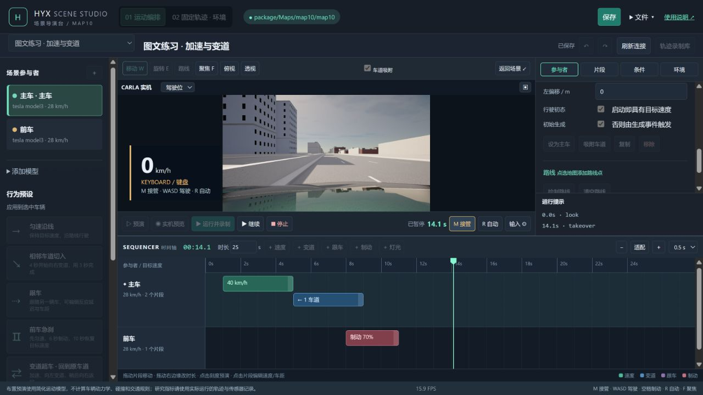

照图先找 **M 接管**和 **R 自动**两个按钮。图中是在暂停状态下示范接管，所以速度为零；点 **继续**后才会实际驾驶。实际练习时按住 W 给油、A/D 转向、S 或空格制动，结束练习点 R 交回自动。

| 按键 | 作用 |
|---|---|
| M | 请求接管 |
| W | 油门 |
| S | 制动 |
| A / D | 左 / 右转向 |
| 空格 | 手动状态下全制动 |
| R | 恢复当前时刻的自动控制目标 |

手动控制优先于主车的自动控制输出，但场景时间、事件和背景车仍继续。返回自动后，不会从接管时刻重新播放时间轴。

当焦点位于输入框、下拉框、文本框或弹窗中时，全局驾驶快捷键不执行。切换窗口、隐藏页面或设备断开会造成输入中断；超过约 **0.35 秒**没有有效输入时，控制端会制动并保持手动控制权。回到页面后重新点接管，不要把无输入当成自动驾驶已经恢复。

### 9.2 固定轨迹重放中的接管

第一次接管会恢复主车物理，并把本次重放标记为**主车轨迹已偏离基准**。背景车辆继续按基准轨迹走。按 R 只恢复物理路线控制，不把主车传送回原轨迹，也不清除偏离标记。

因此，这类记录可用于研究“固定背景运动下的接管”，但不能再被称为主车轨迹完全一致的视觉对照。

### 9.3 手柄和方向盘

点击 **输入 ⚙**，选择输入类型并设置设备序号、转向轴、中心、半量程、死区与反向。油门和制动可以使用按钮或轴；轴输入需要分别填写完全松开和完全踩下时的原始值。窗口可查看设备轴值和按钮值，没有自动标定程序。

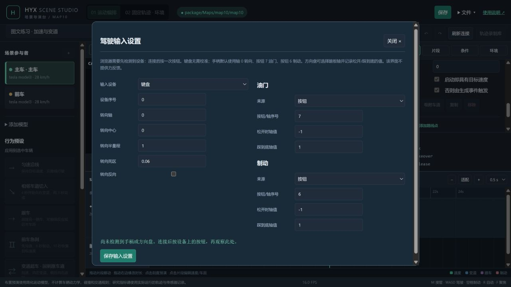

只用键盘时保留“键盘”即可，不用填写手柄轴参数。图中“尚未检测到手柄或方向盘”表示当时浏览器没有识别到可用设备。

连接设备后先按一次按钮，观察浏览器是否识别。保存设置后重新接管，先在低速场景验证左右方向、油门松开和全制动的响应。配置保存在当前浏览器的本地存储中，不随场景 JSON 导出。

截至 2026 年 10 月 17 日，相关硬件兼容性仍未完成实物验收；软件不包含力反馈和界面的换挡、倒车配置。正式使用前应对计划采用的设备和浏览器单独验收，不能仅凭设备设置界面存在就认定可以采集。

## 10 固定轨迹做环境对照

### 10.1 从基准生成环境条件

1. 完成一段物理录制，按第 11 节确认数据完整。保存其运行编号。
2. 停止当前会话，打开 **轨迹录制库**或点击 **02 固定轨迹 · 环境**。
3. 在目标记录旁点 **锁定此轨迹**。软件生成新的环境对照草稿，锁定运动字段，并打开右侧环境面板。
4. 先保留一个基准环境条件，改名并保存；再另存为第二个环境条件，仅修改研究需要的参数。
5. 点击 **重放并录制**，分别从头完成两种条件。
6. 用各自 `events.json` 的 `camera_samples` 查找真实采样时间和文件，再比较对应图像。

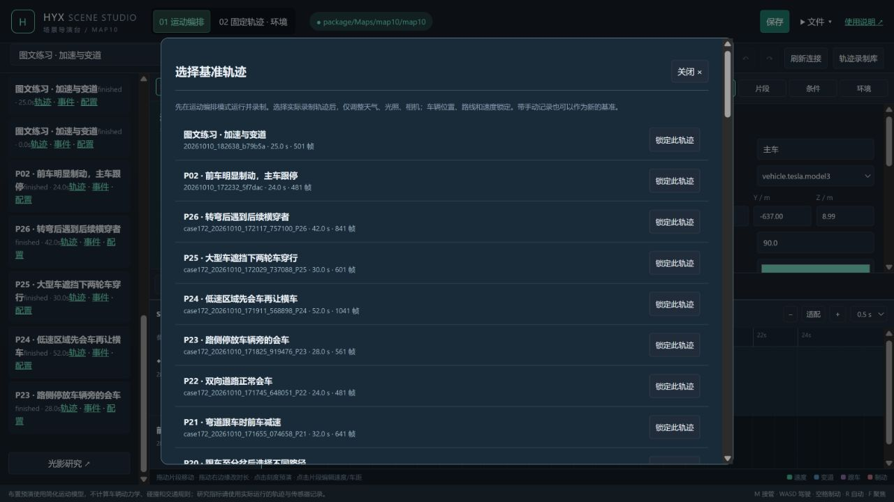

示例中选择的是“图文练习 · 加速与变道”，实际时长 25.0 秒。**名称相同也要核对运行编号**，再点同一行右边的“锁定此轨迹”。你的编号会与截图不同。

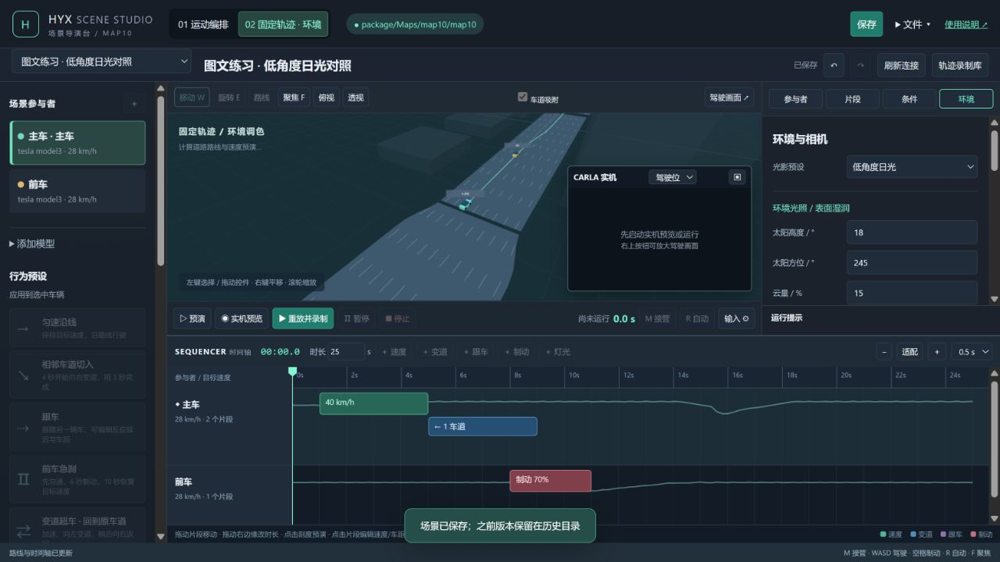

做对后，顶部高亮 **固定轨迹 · 环境**，底部按钮变成 **重放并录制**，右侧是环境参数。示例选择“低角度日光”，另存环境条件名称后保存。车辆和时间轴变灰表示运动已锁定。

若要改变车辆位置、路线、速度或片段，点击 **01 运动编排**生成运动副本，修改后重新录制基准。不能在锁定轨迹场景中夹带运动变化。

### 10.2 环境与相机参数

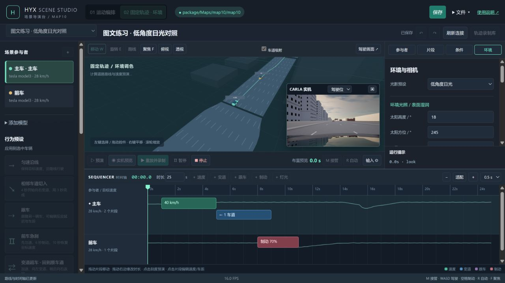

上图是环境条件的**实机预览**，用来检查画面。确认后先停止，再点 **重放并录制**从头保存结果；看见真实道路画面本身，并不表示已经开始正式记录。

**环境**面板可调太阳高度与方位、云量、湿润、雨量、积水、雾浓度和雾起始距离；相机外观包括 Gamma、曝光补偿、Bloom 和运动模糊。使用同一基准时，一次先改变一个研究因素，并在命名中标明条件。

会话中修改天气或相机外观后，点击 **应用到实机预览**才发送到 CARLA；此按钮也能作用于正在运行的会话。相机采样 Hz 需在下一次预览或运行时生效。驾驶视角的正式视频固定为 5740×1010，前景视场角固定 150°；配置中的宽、高只限制 Studio 预览尺寸，视场角设置用于其他相机视角。完整对照应先选定参数再从头运行，避免半途改动而没有记录分析窗口。

目前运行中的环境修改日志只保留预设名和时刻，没有完整保存即时自定义天气、相机覆盖值及相机视角切换。正式试次应固定起始条件；临时调整时另存参数并标记为调试试次，不能指望日志自动还原全部修改。

map10 的导入材质与天空蓝图对 CARLA 天气参数支持有限。湿润或积水数值成功应用，不保证每一块路面出现相应反射，也不会自动改变轮胎摩擦。应保存实际画面作为刺激条件的证据。

### 10.3 对齐截图

软件在每个整数秒区间保存首个合格的正式相机采样，文件名使用**实际采样时间的毫秒值**。因此可能出现 `shot_0001050.jpg`，不能假设一定有 `shot_0001000.jpg`。

以 `camera_samples` 的 `time`、`frame` 和 `file` 为准，再用时间与世界帧号关联 `telemetry.csv`。不同运行的世界帧号通常不同，跨条件比较应先对齐试次时间与基准轨迹状态。若没有相同采样时刻，应明确时间差，不能把相邻时间图像当成完全相同时刻。

界面没有一键 A/B 图片比较或整包下载按钮。截图和完整记录在本地运行目录中；相机窗口的 **▣ 保存画面**仅下载当前 JPEG，不自动构成带完整时间证据的配对比较。

## 11 找到并理解运行数据

项目目录中的 `studio_data/runs/<运行编号>/` 保存每次运行结果。**最近运行**只列出最近 7 项；列表中的 **CSV、视频、CARLA 日志、事件、配置**分别对应下表的 `telemetry.csv`、`video.mp4`、`carla_replay.log`、`events.json`、`scene.json`。导出的 `.py` 独立运行后，也会在同一运行目录结构下生成记录。

| 文件或目录 | 作用 |
|---|---|
| `studio_data/scenes/` | 场景库中已保存的配置 |
| `studio_data/history/` | 场景保存前的旧版本 |
| `scene.json` | 本次启动使用的配置，包括当时的草稿内容 |
| `telemetry.csv` | 各参与者逐帧状态与控制量，用于分析 |
| `take.json` | 可重放轨迹的元数据、基准场景、实际时长和完整性信息 |
| `trajectory.jsonl` | 每行一个时间点及其参与者状态，供重放使用 |
| `events.json` | 事件、碰撞、控制权变化、截图索引、错误和清理结果 |
| `run_manifest.json` | 本次软件、地图、场景指纹，步长与版本等追溯信息 |
| `shot_*.jpg` | 按正式采样时间保存的截图 |
| `frame.jpg` | 最新合成画面，会持续覆盖 |
| `video.mp4` | 驾驶视角 5740×1010 前景及三面后视镜视频；含驾驶舱图层及主车转向提示 |
| `carla_replay.log` | CARLA 原生录制文件，可通过 CARLA Python API 回放；不同于本软件的 `trajectory.jsonl` |
| `status.json`、`console.txt` | 会话状态与排错日志 |

### 11.1 四相机画面与主车转向提示

驾驶视角的视频将前方视野、左后视镜、中央后视镜和右后视镜合成一幅 5740×1010 画面。三面镜子的位置沿用原场景脚本。Studio 的实时预览是缩小版，下载的 `video.mp4` 才是完整像素尺寸。

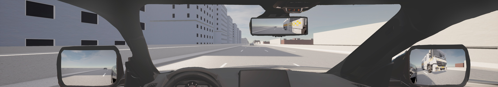

主车打转向灯时，绿色箭头出现在驾驶视野中心略偏左下的位置。下面是左转向灯亮起时的真实录制截图；右转向灯会显示相反方向的箭头。箭头会随仿真时间闪烁，因此某一张截图可能恰好处在熄灭的半周期。

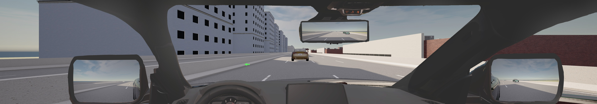

这些图是相机合成结果。环境车的黄灯和红色刹车灯由所选 CARLA 车型的灯光模型决定；正式实验请按实际车型和光照条件核对。完整视频按场景相机 FPS 编码；如果相机画面来不及生成，软件会重复邻近画面维持时间轴，不能仅凭视频文件标出的 FPS 判断独立画面数量。

### 11.2 CSV 的单位

一行表示一个参与者在一个采样时刻的状态；同一帧有多辆车，就有多行。

| 字段 | 含义 |
|---|---|
| `time` | 试次内的仿真时间，秒 |
| `frame` | CARLA 世界帧号；用于同一运行内关联状态与传感器 |
| `id` / `carla_id` | 场景参与者编号 / 本次 CARLA 对象编号 |
| `x,y,z` | 米 |
| `yaw,pitch,roll` | 角度，度 |
| `speed` | 速度，km/h |
| `speed_source` | 速度来自物理状态或录制值；固定轨迹背景通常为 `recorded` |
| `throttle,brake` | 油门、制动输入，0—1 |
| `steer` | 转向输入，−1—1 |
| `lights` | 灯光位状态 |
| `owner` | 当前主车控制权；该值也写在同帧背景行中，不表示背景车被人工驾驶 |

分析时先按 `id` 筛选参与者，再按时间排序。不能把同一帧多车的行数当成仿真帧数，也不能把轨迹库帧数、相机回调数和屏幕 FPS 混为一谈。

### 11.3 判断是否可以作为正式试次

检查以下内容，并在研究记录中注明接纳或排除原因：

1. `scene.json` 是否为计划的条件，`run_manifest.json` 是否对应预期代码、地图和步长。
2. 状态是否正常结束，`events.json` 是否有错误、异常碰撞或残留对象。
3. `take.json` 的 `complete` 是否为真，`covers_scene_duration` 是否为真，实际 `duration` 是否达到计划时长。
4. 风险事件是否触发，时序、实际速度和车辆间距是否符合试次要求。
5. 是否发生人工接管、输入中断、提前停止或环境半途变化。
6. 所用截图是否能通过 `camera_samples` 与 CSV 对齐。

`complete`只说明记录段正常封存，`covers_scene_duration`说明覆盖设计时长，两者都不能代替实验条件检查。`take.json` 的 `manual_override`表示记录中出现过手动控制；`events.json` 中同名字段专指固定轨迹重放时主车退出锁定，物理运行中的手动驾驶不一定让后者为真。

### 11.4 备份和移交

保留场景 JSON 和完整运行目录，维持原运行编号。环境场景还依赖其 `locked_take` 指向的基准目录，至少需要其中的 `take.json` 和 `trajectory.jsonl`。只导出环境场景 JSON 无法在另一台电脑上恢复基准运动。

不要修改原始 CSV、轨迹文件或元数据来“修复”试次。把筛选和统计结果写到单独的分析目录。运行数据、缓存和历史被代码仓库忽略，提交代码不能代替数据备份。

## 12 毕设实验建议流程

### 12.1 从试运行到正式采集

1. 写清研究变量、要保持不变的条件、有效试次标准和输出指标。例如视觉对照中固定基准轨迹、车型、相机视角与分辨率，只改变太阳角度。
2. 为每个条件另存一个命名清楚的场景；记录场景编号、代码版本、地图版本和设备设置。
3. 用实际实验车型做速度与制动校准，确认风险出现时的实际车速和距离。模型目标值不能替代校准值。
4. 先做无被试的完整试运行，确认录制结束、事件与截图对应，以及停止后的清理。
5. 采集时保持单一仿真控制程序，记录每次运行编号、条件、重复序号和异常说明。
6. 分析前按第 11 节核验数据，保留失败试次原文件，并在分析表中标明排除原因。

推荐用 `研究名_条件_重复序号`命名场景或试次说明；身份资料与运行文件分开保管，实验目录中使用研究编号。

### 12.2 当前数据可以支持和不能直接支持的结论

软件可记录自动与手动控制下的实际运动、事件发生的仿真时间，以及带帧号的相机采样。固定轨迹可帮助控制视觉对照中的运动差异。

当前没有测量完整的“传感器采样 → 浏览器显示 → 人看见画面 → 输入到达”的延迟。不能直接把两项仿真时间相减，解释成毫秒级真实人的反应时。研究此指标前，需要增加显示与输入时钟标定。

配置中的 `seed`目前只被保存，没有驱动实验条件随机抽样；界面也没有被试管理、条件平衡分配、统一速度上下限、通用参数关键帧或安全场显示。这些需要另外实现并验收。

**当前适合场景制作和采集流程试运行，尚不能直接开展整套毕设正式被试实验。**Studio 已能输出四相机合成视频、CSV 和 CARLA 原生回放日志；短场景验证不能替代正式显示负载、眼动和实物方向盘的联合验收。按 M 取得控制与程序发送接管都不等于自然方向盘/踏板干预；后者还需在自动观察阶段持续保存原始输入，并标定有意操作的阈值、持续时间和实际生效时刻。眼动有效性、离视触发遮蔽与主观作答流程也需补齐。最新证据见第 14 节。

## 13 实验中减少等待和卡顿

先减少不必要的参与者和其他占用 GPU 的程序，再看实际图像到达率与运行用时。驾驶视角正式视频保持 5740×1010；降低相机采样 Hz 可以减轻负载，但会减少独立画面。调整后要重新启动会话并核对研究条件。

正式条件间应保持相同设置。改变相机位置、采样频率、模糊或曝光可能改变刺激内容，不宜只为了提速而在试次之间临时修改。降低画面负载不等于修改仿真步长；步长变化会影响控制与事件时序，应作为独立变更重新验证。

性能记录建议同时写下场景仿真时长、现实运行用时、相机设置和硬件。仅记录界面某一瞬间的 FPS 不足以比较渲染性能。

## 14 版本验收与使用边界

2026 年 10 月 10 日的代码验收包括：111 项 Python 测试、22 项前端检查、26 个 Case172 场景和 14 次核心运行、重放、暂停、接管及预设实机测试；14 次实机测试中检查的 237 张截图均能对应正式轨迹记录。

本地详细证据位于 `optimization_reports/code_audit_20261010/index.html`。这些结果对应当时的代码与测试环境，不能自动覆盖后续改动、新车型或新硬件，也不代表软件不存在任何未发现问题。

**2026 年 10 月 17 日补充验证：**113 项 Python 测试、22 项前端检查通过；六次 Studio 完整运行覆盖 20/40 Hz 运动、重放与暂停、程序接管、跟停及横车通行，保存 112 张对齐截图。另一次 40 Hz 诊断因状态查询错误在 9.25 秒提前停止，已单独保留，不计入六次完整运行。非暂停试次的仿真/现实时间比约为 0.79，即 1 秒仿真约耗 1.26 秒现实时间；这不是已达到实时交互的结论。

独立的 60 Hz 短时诊断仅验证了 CARLA 底层状态采样，四相机仍有缺帧，且未接入浏览器呈现、眼动或实物方向盘。最新报告与证据目录为 `F:\Soul_copy\05_simulation\carla_feasibility_20261017`：先阅读 `report.md`，数值见 `studio-results.json`、`native60-results.json`，逐项实验要求见 `coverage-review.md`。这是本机证据路径，迁移电脑时需另行复制归档。

**导出功能后续实测：**60 Hz 的 4 秒脚本保存 241 个车辆状态点，环境重放也保存 241 点；带本地相机窗口的 3 秒脚本保存 181 点和驾驶输入日志。各次运行的 `take.json` 均显示覆盖计划时长；实测未接入眼动和实物方向盘。以上属于短时功能验证，不代表完整研究平台的显示延迟和长时稳定性已验收。

**四相机短测：**本机 map10 五车行驶场景以 10 FPS 视频设置录制 2 秒仿真，输出 5740×1010 视频 21 帧，20 对相邻帧均有画面变化；主车 CSV 有 41 个状态点，CARLA 原生日志可读取。启动、录制及收尾合计约 16.3 秒现实时间。这个速度包含初始化和清理，不能推算长试次平均 FPS；正式被试实验还需测持续显示与输入延迟。

正式研究还应单独确认：车型运动校准、地图目标区域、参与者初态、计划使用的输入设备，以及研究指标需要的显示与时间精度。

## 15 常见问题

| 现象 | 处理方法 |
|---|---|
| 页面提示 CARLA 未连接 | 确认 CARLA 已 Play、端口 2000 可用，再点刷新连接 |
| 当前地图不匹配 | 在 CARLA 中打开场景指定地图；软件没有地图切换按钮 |
| 世界由其他客户端控制 tick | 停止其他仿真客户端，确认世界恢复异步状态；不应强行与另一同步程序共用 |
| 无法开始录制 | 先停止实机预览或上一会话，等清理完成；再处理校验提示 |
| 生成失败或位置被占用 | 检查对象是否重叠、Z 是否位于路面，重新吸附并预览 |
| 路线不连通或绕路异常 | 删除问题路线点，沿同向且连通的道路重新绘制 |
| 无法拖动车辆 | 停止会话，切回运动编排，播放头归零，退出路线模式 |
| 数值被恢复为原值 | 输入为空、非数值或超出范围；填写合法数值后再离开输入框 |
| 片段重叠或超出时长 | 调整开始时间和持续时间；速度与制动不能重叠；先延长总时长再安排后续片段 |
| 主车或模型校验不通过 | 主车改为车辆并初始生成；行人用行人行为，静态道具用静止行为 |
| 轨迹库没有记录 | 实机预览不产生 take；物理运行需产生多帧并正常封存，检查运行日志 |
| 接管后按键无响应 | 点击驾驶区域，退出输入框或弹窗，重新接管；检查设备映射与输入状态 |
| 雨天画面变化很小 | 检查已点击应用或重新运行，再核对地图材质与天空的支持情况 |
| 仿真比现实时间慢 | 降低相机负载后重启会话；用仿真时长和现实用时分别评估 |
| 改过地图但编辑器道路仍旧 | 同名地图缓存可能未失效；停止会话后由维护者重启编辑服务 |
| 异常关闭后有残留车辆或同步占用 | 保留运行编号、日志和状态，让维护者按手册检查；不要批量删除整个 CARLA 世界的对象 |

报告问题时提供：运行编号、场景名称、具体操作、预期和实际结果，以及 `scene.json`、`status.json`、`events.json`、`console.txt`。若是画面问题，再提供截图及其 `camera_samples` 条目。这样维护者能区分编排、控制、地图和显示问题。

## 16 快捷键与术语速查

编辑时：**W**移动、**E**旋转、**F**聚焦、**空格**启停离线预演；**Ctrl+S**保存、**Ctrl+Z**撤销、**Ctrl+Y / Ctrl+Shift+Z**重做。运行中完成手动接管后，W 和空格用于驾驶，详见第 9 节。

| 名称 | 本软件中的意思 |
|---|---|
| 场景 scene | 计划：有哪些参与者、怎样运动、触发哪些事件、使用什么环境 |
| 主车 ego | 可以人工接管、承载主要观察相机的车辆 |
| 片段 clip | 在指定时间区间内执行的动作 |
| 条件事件 event | 条件首次满足时触发的一次动作或标记 |
| 运行 run | 某个场景的一次实际执行，具有独立运行编号 |
| 轨迹录制 take | 正常封存的逐帧状态及元数据，可作为重放基准 |
| 仿真步 tick | 推进一次世界计算 |
| 步长 dt | 一步增加的仿真秒数，默认 0.05 |
| 同步模式 | 仿真等待指定客户端发出推进请求 |
| 目标速度 | 控制器试图达到的速度 |
| 实际速度 | CARLA 状态或基准录制中真正发生的速度 |
| 运行清单 manifest | 记录版本、指纹和关键设置的追溯文件 |

需要修改软件时，从[开发维护手册](developer-maintenance-manual.md)的接手步骤开始；仅操作实验时，以本手册的流程与实际界面为准。
